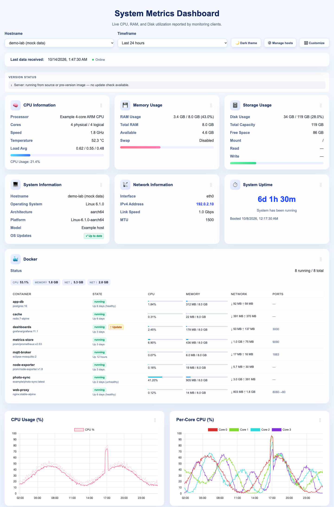

# statix

[](https://hub.docker.com/r/midnightappcoder/statix)
[](https://github.com/chandanankush/statix/actions/workflows/docker-publish.yml)

Monitor your home lab from one self-hosted dashboard. A Python agent collects host metrics on macOS or Raspberry Pi/Linux; a Flask server stores them in SQLite and displays CPU, memory, disk, network, and Docker details.

[Install the server](#1-start-the-server) · [Install an agent](#2-install-the-agent-on-each-host) · [Questions and feedback](https://github.com/chandanankush/statix/discussions)



*Actual interface, captured from an isolated local server. All host identities and metrics are mock data; this is not a production deployment or performance benchmark.* [Short theme walkthrough](docs/assets/dashboard-demo.gif) (two screenshots, condensed timing).

## What you can do

- Chart CPU, per-core load, CPU temperature, memory, disk I/O, and network history across hosts, from 15 minutes to 30 days.
- Inspect host details, uptime, active interfaces, and a per-container Docker table (CPU, memory, network, ports) when available.
- Switch themes and customize card order, visibility, and visual alert thresholds.
- Configure retention and optional CPU/RAM webhook alerts on the server.

See [dashboard details](docs/dashboard-features.md) for platform-dependent metrics and display options.

## Quick start

Requirements: Docker for the server; Python 3.9+ for agents. The installers target macOS and Debian-based Linux/Raspberry Pi OS (other environments need their own validation). The installers create persistent services, so you may prefer to read a script before running it — see [Review before running](#review-before-running).

### 1. Start the server

Requires Docker. Pick one:

**One-line installer** (pulls the published image, prompts for a port and data directory):
```sh
bash <(curl -fsSL https://raw.githubusercontent.com/chandanankush/statix/main/server/install.sh)
```

**Docker:**
```sh
docker run -d \
  --name statix \
  --restart unless-stopped \
  -p 5050:5000 \
  -v statix_data:/app/data \
  midnightappcoder/statix:latest
```
Use `-p 127.0.0.1:5050:5000` instead for a local-only trial; agents on other machines then cannot reach it.

**Docker Compose** (from a clone of this repository):
```sh
docker compose up -d
```

Open <http://localhost:5050/dashboard>. Re-running the installer upgrades to the latest image and keeps your data. Ports, data volume, API key, retention and alerting are covered in the [server guide](server/README.md).

### 2. Install the agent on each host

On every macOS or Raspberry Pi/Linux machine you want to monitor:
```sh
bash <(curl -fsSL https://raw.githubusercontent.com/chandanankush/statix/main/client/install.sh)
```
It prompts for your server URL (e.g. `http://<server-ip>:5050`) and the forwarding interval. To skip the prompts:
```sh
curl -fsSL https://raw.githubusercontent.com/chandanankush/statix/main/client/install.sh \
  | bash -s -- --server-url http://<server-ip>:5050 --interval 30
```
The installer sets up a stats service and a forwarder that start at login/boot. Re-running the same command upgrades the agent and restarts the services without losing your configuration.

To uninstall:
```sh
bash <(curl -fsSL https://raw.githubusercontent.com/chandanankush/statix/main/client/uninstall.sh)
```

See the [agent guide](client/README.md) for service management, environment variables, metric payloads, and troubleshooting.

*Optional — CPU temperature on macOS Intel:* `brew install osx-cpu-temp`. It is picked up automatically once on `PATH`; not available on Apple Silicon.

### 3. Explore metrics

Open `http://<server-ip>:5050/dashboard`, then choose a hostname and timeframe. Switch to dark mode or customize cards to focus on the information you need.

### Review before running

Piping a script from the internet into `bash` is convenient but trusts that script. To read it first, download, inspect, then run it:
```sh
curl -fsSLO https://raw.githubusercontent.com/chandanankush/statix/main/client/install.sh
less install.sh
bash install.sh --server-url http://<server-ip>:5050 --interval 30
```
The same works for `server/install.sh` and `client/uninstall.sh`, or run the copies from a clone of this repository.

## Limitations and security

- This is a self-hosted project; installation, backups, and access control are your responsibility. The repository has no automated test suite; container builds do not prove end-to-end compatibility.
- Dashboard and read APIs are unauthenticated. `STATIX_API_KEY` protects settings writes and host clean/delete operations; **metric ingestion (`POST /metrics`) remains unauthenticated**. Keep the stack on a trusted network or behind separate access controls.
- CPU temperature is platform-dependent and unavailable on Apple Silicon. OS/Docker update checks depend on installed tools and external services. On hosts whose kernel disables the memory cgroup (the Raspberry Pi OS default), Docker reports no per-container memory and statix shows an estimate (see the [agent guide](client/README.md)).
- The dashboard loads Chart.js from the jsDelivr CDN, so the browser needs internet access.
- Some dashboard preferences are browser-local. Use a persistent server volume to retain metric history across container replacement.

## Support and contribution

Ask setup questions in [Discussions](https://github.com/chandanankush/statix/discussions), or [report a reproducible issue](https://github.com/chandanankush/statix/issues/new/choose) with sanitized data. Start with the [welcome discussion](https://github.com/chandanankush/statix/discussions/10).

Read [CONTRIBUTING.md](CONTRIBUTING.md) before opening a focused PR. Browse [good first issues](https://github.com/chandanankush/statix/labels/good%20first%20issue) and [testing requests](https://github.com/chandanankush/statix/labels/help%20wanted).

Technical references: [architecture](ARCHITECTURE.md), [client](client/README.md), [server](server/README.md), and [deployment](DEPLOYMENT.md). No license file is currently supplied; this documentation does not grant additional reuse rights.
